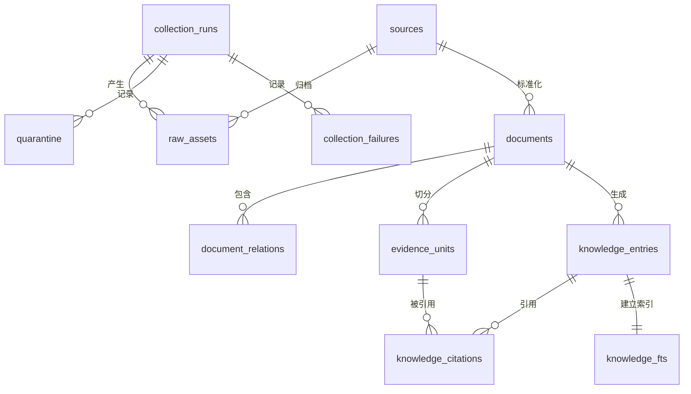
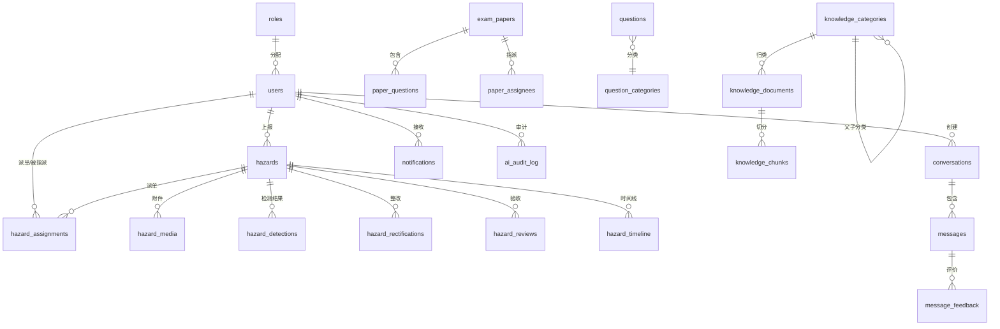

---
AIGC:
    Label: "1"
    ContentProducer: 001191440300708461136T1XGW3
    ProduceID: 619a68374c198f2d1dccd9a31deded68_340d0519971511f19c51525400287e28
    ReservedCode1: UfN5u1uKY4dOzmC1qAoH3PMXFtr76weLdn7PKoSO5x4axaFl92QtKaA/KCbDqcRPoBVccsY6kPrxWuud0WPpaC/5MbJuNVFJYeK/0krCafEcK8UeylluU0LjqDUlBim0qy22QuWpJ3EKp0tb/hvnDjE8yqMaJDkl6Dvw8J94y3bGsaKNGTJggE+rJbw=
    ContentPropagator: 001191440300708461136T1XGW3
    PropagateID: 619a68374c198f2d1dccd9a31deded68_340d0519971511f19c51525400287e28
    ReservedCode2: UfN5u1uKY4dOzmC1qAoH3PMXFtr76weLdn7PKoSO5x4axaFl92QtKaA/KCbDqcRPoBVccsY6kPrxWuud0WPpaC/5MbJuNVFJYeK/0krCafEcK8UeylluU0LjqDUlBim0qy22QuWpJ3EKp0tb/hvnDjE8yqMaJDkl6Dvw8J94y3bGsaKNGTJggE+rJbw=
---

---
AIGC:
    Label: "1"
    ContentProducer: 001191440300708461136T1XGW3
    ProduceID: 619a68374c198f2d1dccd9a31deded68_8b351bd495f311f1b6b5525400287e28
    ReservedCode1: dRJaYCcrVLuaQwTlJimX+nso1d4QRgNEofV4RIlWKle6Zy4Wy3sePwgC5wgMtZgkG6Pt76N/cBOwS6PFvwwUflpnf9UvX1TzzGyzithQP23iFcX4xhOXHJGlXBlZ7P6jR0sYIgoopffmXEv/E7SWHB691WyEX+GJRB7gopH4WpuUpt3HHaKZTFAVyjA=
    ContentPropagator: 001191440300708461136T1XGW3
    PropagateID: 619a68374c198f2d1dccd9a31deded68_8b351bd495f311f1b6b5525400287e28
    ReservedCode2: dRJaYCcrVLuaQwTlJimX+nso1d4QRgNEofV4RIlWKle6Zy4Wy3sePwgC5wgMtZgkG6Pt76N/cBOwS6PFvwwUflpnf9UvX1TzzGyzithQP23iFcX4xhOXHJGlXBlZ7P6jR0sYIgoopffmXEv/E7SWHB691WyEX+GJRB7gopH4WpuUpt3HHaKZTFAVyjA=
---

# 蜀道安全助手 — 数据库设计文档

> **数据库文件**：`database/transport_safety_kb.sqlite3`（知识库） + `database/app.db`（业务数据）  
> **数据库引擎**：SQLite 3（含 FTS5 全文检索扩展）  
> **Schema 版本**：1  
> **最近采集任务**：`collect-20260811-212521-3ff8c2dc`（2026-08-11 完成）  
> **审核状态**：机器初审 / 待核验层  
> **统计概览**：93 数据源 → 121 文档 → 1736 证据单元 → 1736 知识条目

---

## 0. 命名与存储规范

| 项目 | 规定 |
|------|------|
| 数据库引擎 | SQLite 3.35+（含 FTS5 扩展） |
| 文件位置 | 知识库：`database/transport_safety_kb.sqlite3`，业务数据：`database/app.db` |
| 字符编码 | UTF-8 |
| 时间格式 | ISO 8601 字符串，如 `2026-08-11T13:25:22+00:00` |
| 布尔值 | `INTEGER`，仅允许 `0` 或 `1` |
| 数组 / 对象 | UTF-8 JSON 文本，字段名以 `_json` 结尾 |
| 主键策略 | 业务实体使用稳定文本 ID；日志/记录类使用 `AUTOINCREMENT` 整数 |
| 全文检索 | SQLite FTS5；不可用时回退普通表 `LIKE` 查询 |
| 默认访问 | 查询工具以 `mode=ro` 和 `PRAGMA query_only=ON` 只读访问 |
| 数据库重建 | 离线临时库完整重建 → 验证通过 → 原子替换正式库 |

---

## 0.1 逻辑分层

| 层级 | 数据库 | 表 | 用途 |
|------|--------|----|------|
| 模式层 | KB | `schema_metadata` | 保存模式版本、FTS 能力和统一审核状态 |
| 运行层 | KB | `collection_runs` | 保存每轮采集任务及汇总 |
| 来源层 | KB | `sources` | 保存来源登记、发布主体和权威属性 |
| 原档层 | KB | `raw_assets` | 保存每份本地原档、哈希和采集元数据 |
| 文档层 | KB | `documents`、`document_relations` | 保存标准化文档和文档间关系 |
| 证据层 | KB | `evidence_units` | 保存可精确引用的条款或段落 |
| 知识层 | KB | `knowledge_entries`、`knowledge_citations` | 保存检索条目及证据引用 |
| 检索层 | KB | `knowledge_fts` | 保存主题和结论的全文检索索引 |
| 治理层 | KB | `quarantine`、`collection_failures` | 保存隔离记录和采集失败记录 |
| **用户层** | APP | `users`、`roles` | 用户账户与 RBAC 角色 |
| **隐患层** | APP | `hazards`、`hazard_media`、`hazard_assignments`、`hazard_rectifications`、`hazard_reviews`、`hazard_timeline` | 隐患全生命周期管理 |
| **AI会话层** | APP | `conversations`、`messages`、`message_feedback` | AI 问答会话与评价 |
| **考试层** | APP | `question_categories`、`questions`、`exam_papers`、`paper_questions`、`paper_assignees` | 题库、组卷、出题历史 |
| **通知层** | APP | `notifications`、`notification_preferences` | 站内消息通知 |
| **配置层** | APP | `quick_questions`、`sensitive_words` | 快捷问题、敏感词库 |
| **审计层** | APP | `ai_audit_log` | AI 对话全量审计 |
| **AI 模型层** | APP | `ai_model_config` | AI 模型配置（类型/厂商/置信度/启用状态） |
| **模型测试层** | APP | `ai_test_sets`、`ai_test_items`、`ai_test_results` | 模型测试集、测试条目、测试结果 |
| **RAG 配置层** | APP | `rag_config` | RAG 分块/检索/重排参数配置 |
| **知识库管理层** | APP | `knowledge_categories`、`knowledge_documents`、`knowledge_chunks` | 管理端上传知识库的分类、文档与分块记录 |

---

## 1. ER 关系总览

### 1.1 知识库 ER 图（transport_safety_kb.sqlite3）



### 1.2 业务数据 ER 图（app.db）



### 1.3 ASCII 结构图

```
┌──────────────────┐       ┌──────────────────┐
│  collection_runs │       │     sources      │
│  (采集任务)       │       │   (数据来源)      │
└────────┬─────────┘       └────────┬─────────┘
         │ 1:N                      │ 1:N
    ┌────┴────────┐          ┌──────┴──────────────┐
    ▼             ▼          ▼                      ▼
┌──────────┐ ┌──────────┐ ┌──────────┐      ┌──────────┐
│raw_assets│ │quarantine│ │documents │      │raw_assets│
│(原始资源) │ │ (隔离区)  │ │ (文档)   │      │(原始资源) │
└──────────┘ └──────────┘ └────┬─────┘      └──────────┘
         ┌─────────────────────┤
         │ 1:N                 │ 1:N
         ▼                     ▼
┌──────────────┐     ┌──────────────────┐
│document_     │     │  evidence_units   │
│relations     │     │  (证据单元)        │
└──────────────┘     └────────┬─────────┘
                              │ 1:N
              ┌───────────────┴───────────────┐
              ▼                               ▼
    ┌────────────────────┐      ┌────────────────────┐
    │ knowledge_entries  │      │ knowledge_citations│
    │ (知识条目)          │◄─────│ (知识引用)          │
    └──────────┬─────────┘ 1:N └────────────────────┘
               │
               ▼ (FTS5 同步)
    ┌────────────────────┐
    │   knowledge_fts    │
    │  (全文检索虚拟表)    │
    └────────────────────┘
```

**知识库关系传递链**：`sources` → `documents` → `evidence_units` → `knowledge_entries`

### 1.4 主追溯链路

```
collection_runs ──→ raw_assets ──→ sources ──→ documents
                                                  │
                                    ┌─────────────┤
                                    ▼             ▼
                            evidence_units   knowledge_entries
                                    │             │
                                    └──────┬──────┘
                                           ▼
                                  knowledge_citations
```

结构化知识必须能够通过 `knowledge_citations.evidence_id` 回到证据单元，再通过 `evidence_units.document_id` 和 `documents.raw_path` 回到本地原档文件。

---

## 2. 表结构详情 — 知识库数据库（transport_safety_kb.sqlite3）

### 2.1 sources（数据来源）

存储知识库所有文档的元信息来源，每条记录对应一个独立的数据源（法规、部门规章、事故调查报告等）。

| 字段 | 类型 | 约束 | 说明 |
|------|------|------|------|
| `source_id` | TEXT | PRIMARY KEY | 来源唯一标识，格式：`{plugin}-{name}-{year}` |
| `plugin` | TEXT | NOT NULL | 采集插件名（`local_file_plugin` / `direct_url_plugin`） |
| `source_uri` | TEXT | NOT NULL | 来源 URI（本地 `file://` 或远程 `https://`） |
| `title` | TEXT | NOT NULL | 来源标题 |
| `publisher` | TEXT | NOT NULL | 发布单位 |
| `document_type` | TEXT | NOT NULL | 文档类型：法律 / 行政法规 / 监管文件 / 企业制度 / 操作规程 / 应急预案 / 事故调查材料 |
| `authority_level` | TEXT | NOT NULL | 权威等级：A（最高） |
| `version_status` | TEXT | NOT NULL | 版本状态（当前有效候选 / 已废止等） |
| `metadata_json` | TEXT | NOT NULL | 完整元数据 JSON，含 applicable_activity、applicable_role 等 |

**索引**：`idx_sources_authority`(authority_level)、`idx_sources_document_type`(document_type)

**当前数据量**：93 行

---

### 2.2 collection_runs（采集运行记录）

| 字段 | 类型 | 约束 | 说明 |
|------|------|------|------|
| `task_id` | TEXT | PRIMARY KEY | 采集任务 ID，格式：`collect-{YYYYMMDD}-{HHMMSS}-{8位hex}` |
| `completed_at` | TEXT | NOT NULL | 任务完成时间（ISO 8601） |
| `summary_json` | TEXT | NOT NULL | 采集摘要 JSON，含文档数、类型分布、企业主体数等 |

**当前数据量**：1 行

---

### 2.3 raw_assets（原始资源）

| 字段 | 类型 | 约束 | 说明 |
|------|------|------|------|
| `raw_asset_id` | TEXT | PRIMARY KEY | 原始资源 ID，格式：`raw_{16位hex}` |
| `task_id` | TEXT | NOT NULL, FK→collection_runs | 所属采集任务 |
| `source_id` | TEXT | NOT NULL, FK→sources | 所属数据来源 |
| `requested_uri` | TEXT | NOT NULL | 请求时的 URI |
| `final_uri` | TEXT | NOT NULL | 最终获取的 URI（跟随重定向后） |
| `retrieved_at` | TEXT | NOT NULL | 获取时间（ISO 8601） |
| `status_code` | INTEGER | NOT NULL | HTTP 状态码 / 本地 200 表示成功 |
| `media_type` | TEXT | NOT NULL | MIME 类型（`application/pdf` / `text/html`） |
| `raw_sha256` | TEXT | NOT NULL | 原始文件 SHA-256 哈希 |
| `raw_path` | TEXT | NOT NULL | 存档路径（相对 `source_archive/`） |
| `archive_metadata_path` | TEXT | NOT NULL | 存档元数据 JSON 路径 |
| `transport` | TEXT | NOT NULL | 传输方式（`curl` / `local-file`） |
| `transport_note` | TEXT | NOT NULL | 传输备注 |

**外键**：`source_id` → `sources.source_id`，`task_id` → `collection_runs.task_id`

**当前数据量**：93 行

---

### 2.4 documents（文档）

知识库的核心表，存储已解析的法规文件、事故调查报告、企业制度等完整文档及其元信息。

| 字段 | 类型 | 约束 | 说明 |
|------|------|------|------|
| `document_id` | TEXT | PRIMARY KEY | 文档 ID，格式：`doc_{16位hex}` |
| `source_id` | TEXT | NOT NULL, FK→sources | 所属来源 |
| `source_uri` | TEXT | NOT NULL | 源文件 URI |
| `title` | TEXT | NOT NULL | 文档标题 |
| `publisher` | TEXT | NOT NULL | 发布单位 |
| `document_type` | TEXT | NOT NULL | 文档类型 |
| `published_at` | TEXT | NOT NULL | 发布日期 |
| `effective_from` | TEXT | NOT NULL | 生效日期 |
| `effective_to` | TEXT | NOT NULL | 失效日期（空=无明确终止） |
| `version_status` | TEXT | NOT NULL | 版本状态 |
| `jurisdiction` | TEXT | NOT NULL | 管辖范围（国家 / 地方） |
| `applicable_roles_json` | TEXT | NOT NULL | JSON 数组：适用角色 |
| `applicable_activities_json` | TEXT | NOT NULL | JSON 数组：适用业务活动 |
| `authority_level` | TEXT | NOT NULL | 权威等级 |
| `license_status` | TEXT | NOT NULL | 许可状态（公开发布等） |
| `content_hash` | TEXT | NOT NULL | 内容 SHA-256 |
| `retrieved_at` | TEXT | NOT NULL | 检索时间 |
| `section_locator` | TEXT | NOT NULL | 章节定位方式（PDF页码与条款 / HTML正文） |
| `review_status` | TEXT | NOT NULL | 审核状态 |
| `publication_layer` | TEXT | NOT NULL | 发布层级（待核验层 / 正式层） |
| `raw_path` | TEXT | NOT NULL | 存档文件路径 |
| `text` | TEXT | NOT NULL | 全文内容 |
| `fetch_status` | TEXT | NOT NULL | 抓取方式（`local-file` / `curl`） |
| `governance_notes_json` | TEXT | NOT NULL | 治理备注 JSON |

**索引**：`idx_documents_review_status`、`idx_documents_authority`、`idx_documents_version_status`、`idx_documents_document_type`

**外键**：`source_id` → `sources.source_id`

**当前数据量**：121 行

---

### 2.5 evidence_units（证据单元）

将文档按语义段落切分为可独立引用的最小证据单元，每条对应一个条款或自然段落。

| 字段 | 类型 | 约束 | 说明 |
|------|------|------|------|
| `evidence_id` | TEXT | PRIMARY KEY | 证据 ID，格式：`ev_{16位hex}` |
| `document_id` | TEXT | NOT NULL, FK→documents (ON DELETE CASCADE) | 所属文档 |
| `source_uri` | TEXT | NOT NULL | 源文件 URI（冗余，便于追溯） |
| `title` | TEXT | NOT NULL | 证据标题（文档标题） |
| `locator` | TEXT | NOT NULL | 在原文中的定位（页码/条款号/段落位置） |
| `text` | TEXT | NOT NULL | 证据文本内容 |
| `content_hash` | TEXT | NOT NULL | 内容 SHA-256 |
| `authority_level` | TEXT | NOT NULL | 权威等级 |
| `review_status` | TEXT | NOT NULL | 审核状态 |

**索引**：`idx_evidence_document_id`(document_id)

**外键**：`document_id` → `documents.document_id`（级联删除）

**当前数据量**：1736 行

---

### 2.6 knowledge_entries（知识条目）

从证据单元提炼出的结构化知识条目，附带多维度标签，是 AI 问答的直接检索对象。

| 字段 | 类型 | 约束 | 说明 |
|------|------|------|------|
| `knowledge_id` | TEXT | PRIMARY KEY | 知识 ID，格式：`kb_{16位hex}` |
| `document_id` | TEXT | NOT NULL, FK→documents (ON DELETE CASCADE) | 所属文档 |
| `topic` | TEXT | NOT NULL | 主题（如"安全生产法 / 第2页 / 第一条"） |
| `document_type` | TEXT | NOT NULL | 文档类型 |
| `version_status` | TEXT | NOT NULL | 版本状态 |
| `risk_categories_json` | TEXT | NOT NULL | JSON 数组：风险类别标签 |
| `applicable_roles_json` | TEXT | NOT NULL | JSON 数组：适用角色标签 |
| `applicable_activities_json` | TEXT | NOT NULL | JSON 数组：适用活动标签 |
| `conclusion` | TEXT | NOT NULL | 知识结论（条款原文摘要或结论） |
| `authority_level` | TEXT | NOT NULL | 权威等级 |
| `review_status` | TEXT | NOT NULL | 审核状态 |
| `publication_layer` | TEXT | NOT NULL | 发布层级 |
| `invalidated` | INTEGER | NOT NULL, CHECK(0/1) | 是否作废（0=有效，1=作废） |

**索引**：`idx_knowledge_review_status`、`idx_knowledge_version_status`、`idx_knowledge_document_id`

**外键**：`document_id` → `documents.document_id`（级联删除）

**当前数据量**：1736 行

---

### 2.7 knowledge_citations（知识引用）

记录每条知识条目引用了哪些证据单元（N:N 连接表）。

| 字段 | 类型 | 约束 | 说明 |
|------|------|------|------|
| `knowledge_id` | TEXT | NOT NULL, FK→knowledge_entries (ON DELETE CASCADE) | 知识 ID |
| `citation_order` | INTEGER | NOT NULL | 引用序号（从 1 开始） |
| `evidence_id` | TEXT | NOT NULL, FK→evidence_units | 被引用证据 ID |
| `source_uri` | TEXT | NOT NULL | 源文件 URI |
| `locator` | TEXT | NOT NULL | 定位信息 |
| — | — | PRIMARY KEY | (`knowledge_id`, `citation_order`) |

**当前数据量**：1736 行

---

### 2.8 document_relations（文档关联）

| 字段 | 类型 | 约束 | 说明 |
|------|------|------|------|
| `relation_id` | TEXT | PRIMARY KEY | 关系 ID |
| `document_id` | TEXT | NOT NULL, FK→documents (ON DELETE CASCADE) | 关联源文档 |
| `relation_text` | TEXT | NOT NULL | 关系描述文本 |

**当前数据量**：8 行

---

### 2.9 collection_failures（采集失败记录）

| 字段 | 类型 | 约束 | 说明 |
|------|------|------|------|
| `failure_id` | INTEGER | PRIMARY KEY AUTOINCREMENT | 自增主键 |
| `task_id` | TEXT | NOT NULL, FK→collection_runs | 所属采集任务 |
| `stage` | TEXT | NOT NULL | 失败阶段 |
| `source_id` | TEXT | — | 失败的来源 ID |
| `record_json` | TEXT | NOT NULL | 失败详情 JSON |

**当前数据量**：0 行

---

### 2.10 quarantine（隔离区）

| 字段 | 类型 | 约束 | 说明 |
|------|------|------|------|
| `quarantine_id` | TEXT | PRIMARY KEY | 隔离记录 ID |
| `task_id` | TEXT | NOT NULL, FK→collection_runs | 所属采集任务 |
| `source_id` | TEXT | — | 来源 ID |
| `record_json` | TEXT | NOT NULL | 隔离记录 JSON |

**当前数据量**：0 行

---

### 2.11 schema_metadata（模式元数据）

| 字段 | 类型 | 约束 | 说明 |
|------|------|------|------|
| `key` | TEXT | PRIMARY KEY | 配置键 |
| `value` | TEXT | NOT NULL | 配置值 |

**当前配置**：`schema_version`=1、`fts5_available`=1、`review_status`=机器初审/待核验层

---

### 2.12 knowledge_fts（全文检索虚拟表）

FTS5 虚拟表，为 `knowledge_entries` 的 `topic` 和 `conclusion` 字段建立全文索引。

```sql
CREATE VIRTUAL TABLE knowledge_fts USING fts5(
    knowledge_id UNINDEXED,
    topic,
    conclusion
)
```

配套内部表（由 SQLite FTS5 自动管理）：`knowledge_fts_config`、`knowledge_fts_content`、`knowledge_fts_data`、`knowledge_fts_docsize`、`knowledge_fts_idx`

**同步数据量**：1736 行（与 knowledge_entries 一一对应）

---

## 3. 表结构详情 — 业务数据库（app.db）

### 3.1 roles（角色表）

RBAC 角色定义，两级权限模型。

| 字段 | 类型 | 约束 | 说明 |
|------|------|------|------|
| `role_id` | INTEGER | PRIMARY KEY AUTOINCREMENT | 角色 ID |
| `name` | TEXT | NOT NULL, UNIQUE | 角色名：`Admin` / `User` |
| `description` | TEXT | NOT NULL | 角色描述 |
| `created_at` | TEXT | NOT NULL | 创建时间 |

**预置角色**：

| role_id | name | description |
|---------|------|-------------|
| 1 | Admin | 系统管理员，拥有最高权限 |
| 2 | User | 普通用户，可操作本人数据 |

---

### 3.2 users（用户表）

| 字段 | 类型 | 约束 | 说明 |
|------|------|------|------|
| `user_id` | TEXT | PRIMARY KEY | 用户唯一标识，格式：`U{4位数字}` |
| `username` | TEXT | NOT NULL, UNIQUE | 用户名/工号 |
| `password_hash` | TEXT | NOT NULL | BCrypt 加盐密码哈希 |
| `name` | TEXT | NOT NULL | 真实姓名 |
| `role_id` | INTEGER | NOT NULL, FK→roles | 角色 ID |
| `department` | TEXT | NOT NULL | 所属部门 |
| `project` | TEXT | NOT NULL | 所属项目/标段 |
| `phone` | TEXT | — | 手机号 |
| `is_active` | INTEGER | NOT NULL, DEFAULT 1 | 是否启用（0=禁用，1=启用） |
| `last_login_at` | TEXT | — | 最后登录时间 |
| `created_at` | TEXT | NOT NULL | 创建时间 |
| `updated_at` | TEXT | NOT NULL | 更新时间 |

**索引**：`idx_users_role`(role_id)、`idx_users_department`(department)、`idx_users_project`(project)

---

### 3.3 hazards（隐患表）

核心业务表，存储隐患全生命周期数据。对应 PRD H01-H06。

| 字段 | 类型 | 约束 | 说明 |
|------|------|------|------|
| `hazard_id` | TEXT | PRIMARY KEY | 隐患编号，格式：`HD-YYYYMMDD-XXXX` |
| `title` | TEXT | NOT NULL | 隐患标题（≤ 100 字） |
| `description` | TEXT | NOT NULL | 详细描述（≤ 2000 字） |
| `level` | TEXT | NOT NULL | 隐患等级：`critical` / `major` / `minor` / `trivial` |
| `category` | TEXT | NOT NULL | 隐患类别：`height_work` / `edge_protection` / `machinery` / `fire_safety` / `temp_electricity` 等 |
| `location` | TEXT | NOT NULL | 发生位置描述 |
| `location_coords` | TEXT | — | GPS 坐标（`"lng,lat"`） |
| `project` | TEXT | NOT NULL | 所属项目/标段 |
| `reporter_id` | TEXT | NOT NULL, FK→users | 上报人 |
| `status` | TEXT | NOT NULL | 状态：`pending` → `processing` → `pending_review` → `closed` / `rejected` |
| `occurred_at` | TEXT | NOT NULL | 发生时间 |
| `created_at` | TEXT | NOT NULL | 上报时间 |
| `updated_at` | TEXT | NOT NULL | 最后更新时间 |

**索引**：`idx_hazards_status`(status)、`idx_hazards_level`(level)、`idx_hazards_category`(category)、`idx_hazards_project`(project)、`idx_hazards_reporter`(reporter_id)

**状态流转**：`pending(待处理) → processing(处理中) → pending_review(待验收) → closed(已闭环) / rejected(已驳回 → 可重新整改 → pending_review)`

---

### 3.4 hazard_media（隐患媒体附件）

存储隐患上报/整改/验收的图片附件。

| 字段 | 类型 | 约束 | 说明 |
|------|------|------|------|
| `media_id` | INTEGER | PRIMARY KEY AUTOINCREMENT | 附件 ID |
| `hazard_id` | TEXT | NOT NULL, FK→hazards (ON DELETE CASCADE) | 所属隐患 |
| `media_type` | TEXT | NOT NULL | 媒体类型：`image_original`（原图）/ `image_annotated`（标注图） |
| `parent_media_id` | INTEGER | —, FK→hazard_media (ON DELETE CASCADE) | 标注图对应的原图 media_id，原图为 null |
| `file_path` | TEXT | NOT NULL | 文件存储路径 |
| `file_size` | INTEGER | NOT NULL | 文件大小（字节） |
| `sort_order` | INTEGER | NOT NULL, DEFAULT 0 | 排序序号 |
| `context` | TEXT | NOT NULL, DEFAULT 'report' | 所属环节：`report` / `rectification` / `review` |
| `uploaded_at` | TEXT | NOT NULL | 上传时间 |

---

### 3.5 hazard_detections（隐患检测结果）

存储隐患上报图片经大模型视觉识别后的检测结果，对应 PRD H09。

| 字段 | 类型 | 约束 | 说明 |
|------|------|------|------|
| `id` | INTEGER | PRIMARY KEY AUTOINCREMENT | 检测结果 ID |
| `hazard_id` | TEXT | NOT NULL, FK→hazards (ON DELETE CASCADE) | 所属隐患 |
| `media_id` | INTEGER | —, FK→hazard_media (ON DELETE CASCADE) | 所属原图 media_id，可空 |
| `label` | TEXT | NOT NULL | 隐患名称/类别 |
| `risk` | TEXT | NOT NULL | 风险等级：`high`（高）/ `medium`（中）/ `low`（低） |
| `bbox_norm` | TEXT | NOT NULL | 归一化边界框 JSON：`[x1, y1, x2, y2]`，取值 0~1 |
| `bbox_px` | TEXT | — | 像素坐标边界框 JSON，可空，默认 null |
| `color_bgr` | TEXT | NOT NULL | 标注框颜色 BGR JSON：`[B, G, R]`（OpenCV 顺序） |
| `conf` | REAL | NOT NULL | 置信度 0~1 |
| `fix` | TEXT | — | 整改建议 |
| `note` | TEXT | — | 隐患位置/说明备注 |
| `created_at` | TEXT | NOT NULL | 识别时间 |

**说明**：`bbox_norm` / `bbox_px` / `color_bgr` 为数组，按 UTF-8 JSON 文本存储（字段名对齐大模型返回 JSON）。

**索引**：`idx_detections_hazard`(hazard_id)、`idx_detections_media`(media_id)

---

### 3.6 hazard_assignments（隐患派单记录）

| 字段 | 类型 | 约束 | 说明 |
|------|------|------|------|
| `assignment_id` | INTEGER | PRIMARY KEY AUTOINCREMENT | 派单 ID |
| `hazard_id` | TEXT | NOT NULL, FK→hazards (ON DELETE CASCADE) | 所属隐患 |
| `assigner_id` | TEXT | NOT NULL, FK→users | 派单人（安全员/管理员） |
| `assignee_id` | TEXT | NOT NULL, FK→users | 整改责任人 |
| `requirements` | TEXT | NOT NULL | 整改要求 |
| `deadline` | TEXT | NOT NULL | 整改截止日期 |
| `priority` | TEXT | NOT NULL | 优先级：`urgent` / `high` / `medium` / `low` |
| `attachments_json` | TEXT | NOT NULL | 附件路径列表 JSON |
| `created_at` | TEXT | NOT NULL | 派单时间 |

---

### 3.7 hazard_rectifications（整改反馈记录）

| 字段 | 类型 | 约束 | 说明 |
|------|------|------|------|
| `rectification_id` | INTEGER | PRIMARY KEY AUTOINCREMENT | 整改 ID |
| `hazard_id` | TEXT | NOT NULL, FK→hazards (ON DELETE CASCADE) | 所属隐患 |
| `assignee_id` | TEXT | NOT NULL, FK→users | 整改人 |
| `measures` | TEXT | NOT NULL | 整改措施描述（≥ 20 字） |
| `images_json` | TEXT | NOT NULL | 整改后照片路径列表 JSON |
| `attachments_json` | TEXT | NOT NULL | 相关附件路径列表 JSON |
| `completed_at` | TEXT | NOT NULL | 整改完成时间 |
| `round` | INTEGER | NOT NULL, DEFAULT 1 | 整改轮次（驳回后递增） |
| `created_at` | TEXT | NOT NULL | 提交时间 |

---

### 3.8 hazard_reviews（验收记录）

| 字段 | 类型 | 约束 | 说明 |
|------|------|------|------|
| `review_id` | INTEGER | PRIMARY KEY AUTOINCREMENT | 验收 ID |
| `hazard_id` | TEXT | NOT NULL, FK→hazards (ON DELETE CASCADE) | 所属隐患 |
| `reviewer_id` | TEXT | NOT NULL, FK→users | 验收人 |
| `result` | TEXT | NOT NULL | 验收结论：`approved` / `rejected` |
| `comment` | TEXT | — | 验收意见（驳回时必填，≥ 10 字） |
| `attachments_json` | TEXT | NOT NULL | 验收附件路径列表 JSON |
| `created_at` | TEXT | NOT NULL | 验收时间 |

---

### 3.9 hazard_timeline（隐患状态流转时间线）

记录隐患全生命周期的每个操作节点，不可篡改。

| 字段 | 类型 | 约束 | 说明 |
|------|------|------|------|
| `timeline_id` | INTEGER | PRIMARY KEY AUTOINCREMENT | 记录 ID |
| `hazard_id` | TEXT | NOT NULL, FK→hazards (ON DELETE CASCADE) | 所属隐患 |
| `action_type` | TEXT | NOT NULL | 操作类型：`reported` / `assigned` / `rectified` / `reviewed` / `urged` |
| `operator_id` | TEXT | NOT NULL, FK→users | 操作人 |
| `note` | TEXT | NOT NULL | 操作备注 |
| `created_at` | TEXT | NOT NULL | 操作时间 |

**索引**：`idx_timeline_hazard`(hazard_id)

---

### 3.10 conversations（AI 会话表）

对应 PRD A02，管理用户 AI 对话会话。

| 字段 | 类型 | 约束 | 说明 |
|------|------|------|------|
| `session_id` | TEXT | PRIMARY KEY | 会话 ID，格式：`sess_{12位hex}` |
| `user_id` | TEXT | NOT NULL, FK→users | 所属用户 |
| `title` | TEXT | NOT NULL | 会话标题（AI 自动概括首问） |
| `message_count` | INTEGER | NOT NULL, DEFAULT 0 | 消息数量 |
| `last_message_preview` | TEXT | — | 最后一条消息预览 |
| `created_at` | TEXT | NOT NULL | 创建时间 |
| `updated_at` | TEXT | NOT NULL | 最后活跃时间 |

**索引**：`idx_conversations_user`(user_id)、`idx_conversations_updated`(updated_at)

**约束**：每个用户最多 100 个会话。

---

### 3.11 messages（AI 消息表）

存储 AI 会话中的每条消息。对应 PRD A01、A03、A06。

| 字段 | 类型 | 约束 | 说明 |
|------|------|------|------|
| `message_id` | TEXT | PRIMARY KEY | 消息 ID，格式：`msg_{12位hex}` |
| `session_id` | TEXT | NOT NULL, FK→conversations (ON DELETE CASCADE) | 所属会话 |
| `role` | TEXT | NOT NULL | 角色：`user` / `assistant` |
| `content` | TEXT | NOT NULL | 消息内容 |
| `sources_json` | TEXT | — | 引用来源列表 JSON（assistant 消息） |
| `status` | TEXT | NOT NULL, DEFAULT 'completed' | 状态：`completed` / `interrupted` |
| `token_count` | INTEGER | — | Token 数量（用于成本统计） |
| `created_at` | TEXT | NOT NULL | 创建时间 |

**索引**：`idx_messages_session`(session_id)

---

### 3.12 message_feedback（AI 回答评价表）

对应 PRD A07，点赞/踩反馈。

| 字段 | 类型 | 约束 | 说明 |
|------|------|------|------|
| `feedback_id` | INTEGER | PRIMARY KEY AUTOINCREMENT | 评价 ID |
| `message_id` | TEXT | NOT NULL, FK→messages (ON DELETE CASCADE) | 被评价消息 |
| `user_id` | TEXT | NOT NULL, FK→users | 评价人 |
| `rating` | TEXT | NOT NULL, CHECK(`rating IN ('like','dislike')`) | 评价：`like` / `dislike` |
| `reasons_json` | TEXT | — | 踩的原因列表 JSON（`inaccurate` / `incomplete` / `misunderstanding` / `off_topic` / `other`） |
| `comment` | TEXT | — | 补充说明（≤ 200 字） |
| `created_at` | TEXT | NOT NULL | 评价时间 |

**约束**：同一用户同一消息仅可评价一次，DDL 层通过 `UNIQUE(message_id, user_id)` 保证；取消评价为物理删除该行（`DELETE /ai/messages/{message_id}/feedback`）

---

### 3.13 quick_questions（快捷问题表）

对应 PRD A04，AI 助手首页推荐问题。

> **保留说明**：管理端对快捷问题的维护接口（POST/PUT/DELETE）已移除，但本表保留--用户端 `GET /ai/quick-questions` 仍从本表读取 `is_active=1` 且按 `roles_json` 过滤当前角色的快捷问题，数据需直接在业务库中预置。

| 字段 | 类型 | 约束 | 说明 |
|------|------|------|------|
| `question_id` | INTEGER | PRIMARY KEY AUTOINCREMENT | 问题 ID |
| `category` | TEXT | NOT NULL | 分类名称（法规类 / 操作规程类 / 应急处置类等） |
| `category_icon` | TEXT | NOT NULL | 分类图标标识（`law` / `operation` / `emergency` 等） |
| `question` | TEXT | NOT NULL | 问题文本 |
| `roles_json` | TEXT | NOT NULL | 可见角色列表 JSON（如 `["User"]`） |
| `is_hot` | INTEGER | NOT NULL, DEFAULT 0 | 是否热门问题 |
| `sort_order` | INTEGER | NOT NULL, DEFAULT 0 | 排序权重 |
| `is_active` | INTEGER | NOT NULL, DEFAULT 1 | 是否启用 |
| `created_at` | TEXT | NOT NULL | 创建时间 |
| `updated_at` | TEXT | NOT NULL | 更新时间 |

---

### 3.14 question_categories（题目分类表）

对应 PRD E01，多级题目分类树。

| 字段 | 类型 | 约束 | 说明 |
|------|------|------|------|
| `category_id` | INTEGER | PRIMARY KEY AUTOINCREMENT | 分类 ID |
| `name` | TEXT | NOT NULL | 分类名称 |
| `parent_id` | INTEGER | —, FK→question_categories | 父分类 ID（NULL 为一级分类） |
| `level` | INTEGER | NOT NULL, DEFAULT 1 | 层级深度 |
| `sort_order` | INTEGER | NOT NULL, DEFAULT 0 | 排序权重 |
| `created_at` | TEXT | NOT NULL | 创建时间 |

---

### 3.15 questions（题库表）

对应 PRD E01、E02，存储所有题目（手动录入 + AI 生成）。

| 字段 | 类型 | 约束 | 说明 |
|------|------|------|------|
| `question_id` | INTEGER | PRIMARY KEY AUTOINCREMENT | 题目 ID |
| `type` | TEXT | NOT NULL | 题型：`single_choice` / `multi_choice` / `true_false` / `essay` |
| `content` | TEXT | NOT NULL | 题干 |
| `options_json` | TEXT | — | 选项 JSON（客观题必填，简答题为 NULL） |
| `answer` | TEXT | NOT NULL | 正确答案（客观题选项key拼接/判断"正确""错误"/简答参考） |
| `explanation` | TEXT | NOT NULL | 解析 |
| `score` | REAL | NOT NULL, DEFAULT 2 | 默认分值 |
| `difficulty` | TEXT | NOT NULL | 难度：`easy` / `medium` / `hard` |
| `category_id` | INTEGER | —, FK→question_categories | 题目分类 |
| `tags_json` | TEXT | NOT NULL | 标签列表 JSON |
| `status` | TEXT | NOT NULL, DEFAULT 'draft' | 状态：`draft` / `pending_review` / `published` / `rejected` |
| `source` | TEXT | NOT NULL, DEFAULT 'manual' | 来源：`manual` / `ai_generated` / `import` |
| `ai_generation_id` | TEXT | — | AI 生成批次 ID（AI 出题时关联） |
| `created_by` | TEXT | NOT NULL, FK→users | 出题人（创建人），用于区分不同用户的不同考题，出题历史记录按出题人展示 |
| `reviewed_by` | TEXT | —, FK→users | 审核人 |
| `reviewed_at` | TEXT | — | 审核时间 |
| `review_comment` | TEXT | — | 审核意见（驳回时记录） |
| `is_deleted` | INTEGER | NOT NULL, DEFAULT 0 | 软删除标记（已被试卷引用的题目物理不可删） |
| `created_at` | TEXT | NOT NULL | 创建时间 |
| `updated_at` | TEXT | NOT NULL | 更新时间 |

**索引**：`idx_questions_type`(type)、`idx_questions_status`(status)、`idx_questions_category`(category_id)、`idx_questions_difficulty`(difficulty)

---

### 3.16 exam_papers（试卷表）

对应 PRD E03，考试试卷定义。

| 字段 | 类型 | 约束 | 说明 |
|------|------|------|------|
| `paper_id` | TEXT | PRIMARY KEY | 试卷 ID，格式：`paper_{12位hex}` |
| `title` | TEXT | NOT NULL | 试卷标题 |
| `description` | TEXT | — | 考试说明 |
| `mode` | TEXT | NOT NULL | 组卷模式：`manual` / `auto` |
| `strategy_json` | TEXT | — | 智能组卷策略 JSON（mode=auto 时必填） |
| `total_score` | REAL | NOT NULL | 总分 |
| `pass_score` | REAL | NOT NULL | 及格分数 |
| `duration` | INTEGER | NOT NULL | 考试时长（分钟） |
| `shuffle_questions` | INTEGER | NOT NULL, DEFAULT 0 | 题目乱序 |
| `shuffle_options` | INTEGER | NOT NULL, DEFAULT 0 | 选项乱序 |
| `anti_cheat` | INTEGER | NOT NULL, DEFAULT 0 | 切屏检测 |
| `max_switch_count` | INTEGER | DEFAULT 3 | 允许切屏次数 |
| `allow_retake` | INTEGER | NOT NULL, DEFAULT 0 | 允许重考 |
| `max_retake_count` | INTEGER | DEFAULT 1 | 最大重考次数 |
| `start_time` | TEXT | NOT NULL | 考试开始时间 |
| `end_time` | TEXT | NOT NULL | 考试结束时间 |
| `status` | TEXT | NOT NULL, DEFAULT 'draft' | 状态：`draft` / `published` / `ended` |
| `created_by` | TEXT | NOT NULL, FK→users | 出题人（创建人），用于区分不同用户的不同考题，出题历史记录按出题人展示 |
| `created_at` | TEXT | NOT NULL | 创建时间 |
| `updated_at` | TEXT | NOT NULL | 更新时间 |

**索引**：`idx_papers_status`(status)、`idx_papers_creator`(created_by)

---

### 3.17 paper_questions（试卷-题目关联表）

| 字段 | 类型 | 约束 | 说明 |
|------|------|------|------|
| `id` | INTEGER | PRIMARY KEY AUTOINCREMENT | 记录 ID |
| `paper_id` | TEXT | NOT NULL, FK→exam_papers (ON DELETE CASCADE) | 试卷 ID |
| `question_id` | INTEGER | NOT NULL, FK→questions | 题目 ID |
| `score` | REAL | NOT NULL | 该题在试卷中的分值 |
| `order` | INTEGER | NOT NULL | 题目序号 |

---

### 3.18 paper_assignees（试卷指派人表）

| 字段 | 类型 | 约束 | 说明 |
|------|------|------|------|
| `id` | INTEGER | PRIMARY KEY AUTOINCREMENT | 记录 ID |
| `paper_id` | TEXT | NOT NULL, FK→exam_papers (ON DELETE CASCADE) | 试卷 ID |
| `assignee_type` | TEXT | NOT NULL | 指派类型：`user` / `department` |
| `assignee_id` | TEXT | NOT NULL | 指派人 ID 或部门 ID |

---

### 3.21 notifications（消息通知表）

对应 PRD H08，站内消息通知。支持单条 / 批量删除（物理删除，删除后不再展示）。

**分类映射**（供分类 tab 与分类型未读计数使用）：`hazard_assigned` / `rectification_submitted` / `review_result` / `rectification_urge` 归隐患类（hazard）。

| 字段 | 类型 | 约束 | 说明 |
|------|------|------|------|
| `notification_id` | TEXT | PRIMARY KEY | 通知 ID，格式：`notif_{12位hex}` |
| `user_id` | TEXT | NOT NULL, FK→users | 接收用户 |
| `type` | TEXT | NOT NULL | 通知类型：`hazard_assigned` / `rectification_submitted` / `review_result` / `rectification_urge` |
| `title` | TEXT | NOT NULL | 通知标题 |
| `content` | TEXT | NOT NULL | 通知内容 |
| `target_type` | TEXT | — | 关联业务类型：`hazard` |
| `target_id` | TEXT | — | 关联业务 ID |
| `is_read` | INTEGER | NOT NULL, DEFAULT 0 | 是否已读 |
| `created_at` | TEXT | NOT NULL | 通知时间 |

**索引**：`idx_notifications_user`(user_id)、`idx_notifications_unread`(user_id, is_read)、`idx_notifications_type`(type)

**消息保留策略**：90 天自动清理。

---

### 3.22 notification_preferences（通知偏好表）

| 字段 | 类型 | 约束 | 说明 |
|------|------|------|------|
| `user_id` | TEXT | PRIMARY KEY, FK→users | 用户 ID |
| `hazard_assigned` | INTEGER | NOT NULL, DEFAULT 1 | 隐患派单通知 |
| `rectification_submitted` | INTEGER | NOT NULL, DEFAULT 1 | 整改反馈通知 |
| `review_result` | INTEGER | NOT NULL, DEFAULT 1 | 验收结果通知 |
| `rectification_urge` | INTEGER | NOT NULL, DEFAULT 1 | 整改催办通知 |
| `updated_at` | TEXT | NOT NULL | 更新时间 |

---

### 3.23 ai_audit_log（AI 审计日志表）

对应 ARCHITECTURE §8.3，记录所有 AI 对话的完整审计信息。

| 字段 | 类型 | 约束 | 说明 |
|------|------|------|------|
| `id` | INTEGER | PRIMARY KEY AUTOINCREMENT | 日志 ID |
| `session_id` | TEXT | —, FK→conversations | 会话 ID |
| `user_id` | TEXT | NOT NULL, FK→users | 用户 ID |
| `user_question` | TEXT | NOT NULL | 用户提问原文 |
| `ai_answer` | TEXT | — | AI 回答全文 |
| `model_used` | TEXT | NOT NULL | 使用的模型（`ernie` / `qwen` / `glm`） |
| `response_time_ms` | INTEGER | NOT NULL | 响应时间（毫秒） |
| `sources_json` | TEXT | — | 引用来源 JSON |
| `filter_action` | TEXT | — | 敏感词过滤动作（`blocked` / `passed` / `output_filtered`） |
| `token_input` | INTEGER | — | 输入 Token 数 |
| `token_output` | INTEGER | — | 输出 Token 数 |
| `scene` | TEXT | NOT NULL | 调用场景：`qa` / `exam_generation` |
| `created_at` | TEXT | NOT NULL | 记录时间 |

**索引**：`idx_audit_session`(session_id)、`idx_audit_user`(user_id)、`idx_audit_time`(created_at)

---

### 3.24 sensitive_words（敏感词库表）

DFA 敏感词过滤引擎的词库存储。

| 字段 | 类型 | 约束 | 说明 |
|------|------|------|------|
| `word_id` | INTEGER | PRIMARY KEY AUTOINCREMENT | 词 ID |
| `word` | TEXT | NOT NULL, UNIQUE | 敏感词 |
| `category` | TEXT | NOT NULL | 分类：`political` / `violence` / `pornography` / `illegal` / `ads` / `privacy` / `other` |
| `is_active` | INTEGER | NOT NULL, DEFAULT 1 | 是否启用 |
| `created_at` | TEXT | NOT NULL | 添加时间 |

---

### 3.25 knowledge_categories（知识库分类表）

管理端知识库的多级分类树，对应 API.md 8.5 分类管理接口（Admin）。

| 字段 | 类型 | 约束 | 说明 |
|------|------|------|------|
| `category_id` | INTEGER | PRIMARY KEY AUTOINCREMENT | 分类 ID |
| `name` | TEXT | NOT NULL | 分类名称 |
| `parent_id` | INTEGER | -, FK->knowledge_categories | 父分类 ID（NULL 为一级分类） |
| `level` | INTEGER | NOT NULL, DEFAULT 1 | 层级深度（服务端按父分类层级 +1 计算） |
| `sort_order` | INTEGER | NOT NULL, DEFAULT 0 | 排序权重 |
| `created_at` | TEXT | NOT NULL | 创建时间 |
| `updated_at` | TEXT | NOT NULL | 更新时间 |

**删除约束**：存在子分类或其下存在文档时不可删除（服务端校验）。

---

### 3.26 knowledge_documents（知识库文档表）

管理端上传的知识库文档记录，对应 API.md 8.1/8.2/8.3/8.4（Admin）。文档经解析、切分后向量化写入 Chroma 集合 `safety_knowledge`（与内置证据集合 `safety_evidence_v1` 分离），本表保存文档元数据与处理状态。

| 字段 | 类型 | 约束 | 说明 |
|------|------|------|------|
| `doc_id` | INTEGER | PRIMARY KEY AUTOINCREMENT | 文档 ID |
| `title` | TEXT | NOT NULL | 文档标题 |
| `doc_type` | TEXT | NOT NULL, DEFAULT 'other' | 文档类型：`regulation`（法规）/ `procedure`（规程）/ `case`（案例）/ `emergency`（应急）/ `other`（其他） |
| `category_id` | INTEGER | -, FK->knowledge_categories | 所属分类 |
| `tags_json` | TEXT | NOT NULL, DEFAULT '[]' | 标签列表 JSON |
| `authority_level` | TEXT | NOT NULL, DEFAULT 'B' | 权威等级：`A` / `B` / `C` |
| `file_path` | TEXT | NOT NULL | 文件存储路径（相对 `uploads` 目录，形如 `knowledge/{uuid}{ext}`） |
| `file_size` | INTEGER | NOT NULL, DEFAULT 0 | 文件大小（字节） |
| `status` | TEXT | NOT NULL, DEFAULT 'parsing' | 处理状态：`parsing` -> `chunking` -> `indexing` -> `indexed` / `failed` |
| `chunk_count` | INTEGER | NOT NULL, DEFAULT 0 | 分块数量 |
| `error_message` | TEXT | - | 失败原因（status=failed 时记录，≤ 500 字） |
| `created_by` | TEXT | NOT NULL, FK->users | 上传人 |
| `created_at` | TEXT | NOT NULL | 创建时间 |
| `updated_at` | TEXT | NOT NULL | 更新时间 |

**状态机**：上传落库置 `parsing` -> 解析完成 `chunking` -> 分块落库 `indexing` -> 向量化 upsert 成功 `indexed`；任一环节失败置 `failed` 并写入 `error_message`（分块已持久化时向量化失败不中断上传）。

**删除联动**：删除文档时同步清理 Chroma 向量（按 `doc_id` 过滤）、`knowledge_chunks` 分块记录与磁盘文件。

---

### 3.27 knowledge_chunks（知识库文档分块表）

上传文档切分后的分块记录，与 Chroma 集合 `safety_knowledge` 中的向量一一对应（向量 id 格式 `kb_{doc_id}_{chunk_index}`）。

| 字段 | 类型 | 约束 | 说明 |
|------|------|------|------|
| `chunk_id` | INTEGER | PRIMARY KEY AUTOINCREMENT | 分块 ID |
| `doc_id` | INTEGER | NOT NULL, FK->knowledge_documents (ON DELETE CASCADE) | 所属文档 |
| `chunk_index` | INTEGER | NOT NULL, DEFAULT 0 | 分块序号（从 0 开始） |
| `content` | TEXT | NOT NULL | 分块文本内容 |
| `created_at` | TEXT | NOT NULL | 创建时间 |

**索引**：`idx_knowledge_chunks_doc`(doc_id)

**切分参数**：`chunk_size` / `chunk_overlap` 运行时从 `rag_config` 读取（默认 500/50，见 §6.5.3）。

---

## 4. 知识库数据库索引策略

### 4.1 业务索引（已创建）

| 表 | 索引名 | 索引字段 | 场景 |
|----|--------|---------|------|
| `documents` | `idx_documents_document_type` | document_type | 按法规类型筛选 |
| `documents` | `idx_documents_authority` | authority_level | 按权威等级筛选 |
| `documents` | `idx_documents_version_status` | version_status | 按版本状态筛选 |
| `documents` | `idx_documents_review_status` | review_status | 按审核状态筛选 |
| `sources` | `idx_sources_document_type` | document_type | 来源类型筛选 |
| `sources` | `idx_sources_authority` | authority_level | 来源权威等级筛选 |
| `evidence_units` | `idx_evidence_document_id` | document_id | 按文档查找所有证据单元 |
| `knowledge_entries` | `idx_knowledge_document_id` | document_id | 按文档查找所有知识条目 |
| `knowledge_entries` | `idx_knowledge_version_status` | version_status | 筛选有效知识 |
| `knowledge_entries` | `idx_knowledge_review_status` | review_status | 按审核状态筛选 |

### 4.2 全文检索索引

| 虚拟表 | 索引字段 | 说明 |
|--------|---------|------|
| `knowledge_fts` | topic, conclusion | FTS5 中文全文索引，支持 BM25 排序 |

---

## 5. 业务数据库索引策略

| 表 | 索引名 | 索引字段 | 场景 |
|----|--------|---------|------|
| `users` | `idx_users_role` | role_id | 按角色筛选用户 |
| `users` | `idx_users_department` | department | 按部门筛选 |
| `users` | `idx_users_project` | project | 按项目筛选 |
| `hazards` | `idx_hazards_status` | status | 按状态筛选隐患 |
| `hazards` | `idx_hazards_level` | level | 按等级筛选 |
| `hazards` | `idx_hazards_category` | category | 按类别筛选 |
| `hazards` | `idx_hazards_project` | project | 按项目筛选 |
| `hazards` | `idx_hazards_reporter` | reporter_id | 按上报人查询 |
| `hazard_timeline` | `idx_timeline_hazard` | hazard_id | 查询隐患时间线 |
| `hazard_detections` | `idx_detections_hazard` | hazard_id | 查询隐患检测结果 |
| `hazard_detections` | `idx_detections_media` | media_id | 按图片查询检测结果 |
| `conversations` | `idx_conversations_user` | user_id | 用户会话列表 |
| `conversations` | `idx_conversations_updated` | updated_at | 按活跃时间排序 |
| `messages` | `idx_messages_session` | session_id | 按会话查消息 |
| `knowledge_chunks` | `idx_knowledge_chunks_doc` | doc_id | 按文档查分块 |
| `questions` | `idx_questions_type` | type | 按题型筛选 |
| `questions` | `idx_questions_status` | status | 按审核状态筛选 |
| `questions` | `idx_questions_category` | category_id | 按分类筛选 |
| `questions` | `idx_questions_difficulty` | difficulty | 按难度筛选 |
| `exam_papers` | `idx_papers_status` | status | 按状态筛选试卷 |
| `exam_papers` | `idx_papers_creator` | created_by | 按创建人查询 |
| `notifications` | `idx_notifications_user` | user_id | 用户消息列表 |
| `notifications` | `idx_notifications_unread` | user_id, is_read | 未读消息计数 |
| `ai_audit_log` | `idx_audit_session` | session_id | 按会话追溯审计 |
| `ai_audit_log` | `idx_audit_user` | user_id | 按用户追溯审计 |
| `ai_audit_log` | `idx_audit_time` | created_at | 按时间范围查询 |

### 索引设计说明

- **高频筛选字段优先**：隐患的 status/level/category、题目的 type/status/difficulty、通知的 user_id/is_read 均建索引。
- **关联查询加速**：各子表通过外键字段建索引（document_id、hazard_id、session_id 等），支撑联表查询。
- **全文检索采用 FTS5**：知识库检索通过 knowledge_fts 虚拟表，支持 BM25 排序。
- **审计日志时间索引**：ai_audit_log 按 created_at 建索引，支撑按时间范围回溯。

---

## 6. 外键关系汇总

### 6.1 知识库数据库外键

| 子表 | 外键字段 | 引用父表 | 引用字段 | 删除策略 |
|------|---------|---------|---------|---------|
| `raw_assets` | `task_id` | `collection_runs` | `task_id` | NO ACTION |
| `raw_assets` | `source_id` | `sources` | `source_id` | NO ACTION |
| `documents` | `source_id` | `sources` | `source_id` | NO ACTION |
| `evidence_units` | `document_id` | `documents` | `document_id` | **CASCADE** |
| `knowledge_entries` | `document_id` | `documents` | `document_id` | **CASCADE** |
| `knowledge_citations` | `knowledge_id` | `knowledge_entries` | `knowledge_id` | **CASCADE** |
| `knowledge_citations` | `evidence_id` | `evidence_units` | `evidence_id` | NO ACTION |
| `document_relations` | `document_id` | `documents` | `document_id` | **CASCADE** |
| `collection_failures` | `task_id` | `collection_runs` | `task_id` | NO ACTION |
| `quarantine` | `task_id` | `collection_runs` | `task_id` | NO ACTION |

### 6.2 业务数据库外键

| 子表 | 外键字段 | 引用父表 | 引用字段 | 删除策略 |
|------|---------|---------|---------|---------|
| `users` | `role_id` | `roles` | `role_id` | NO ACTION |
| `hazards` | `reporter_id` | `users` | `user_id` | NO ACTION |
| `hazard_media` | `hazard_id` | `hazards` | `hazard_id` | **CASCADE** |
| `hazard_media` | `parent_media_id` | `hazard_media` | `media_id` | **CASCADE** |
| `hazard_detections` | `hazard_id` | `hazards` | `hazard_id` | **CASCADE** |
| `hazard_detections` | `media_id` | `hazard_media` | `media_id` | **CASCADE** |
| `hazard_assignments` | `hazard_id` | `hazards` | `hazard_id` | **CASCADE** |
| `hazard_assignments` | `assigner_id` | `users` | `user_id` | NO ACTION |
| `hazard_assignments` | `assignee_id` | `users` | `user_id` | NO ACTION |
| `hazard_rectifications` | `hazard_id` | `hazards` | `hazard_id` | **CASCADE** |
| `hazard_rectifications` | `assignee_id` | `users` | `user_id` | NO ACTION |
| `hazard_reviews` | `hazard_id` | `hazards` | `hazard_id` | **CASCADE** |
| `hazard_reviews` | `reviewer_id` | `users` | `user_id` | NO ACTION |
| `hazard_timeline` | `hazard_id` | `hazards` | `hazard_id` | **CASCADE** |
| `hazard_timeline` | `operator_id` | `users` | `user_id` | NO ACTION |
| `conversations` | `user_id` | `users` | `user_id` | **CASCADE** |
| `messages` | `session_id` | `conversations` | `session_id` | **CASCADE** |
| `message_feedback` | `message_id` | `messages` | `message_id` | **CASCADE** |
| `message_feedback` | `user_id` | `users` | `user_id` | NO ACTION |
| `knowledge_categories` | `parent_id` | `knowledge_categories` | `category_id` | NO ACTION |
| `knowledge_documents` | `category_id` | `knowledge_categories` | `category_id` | NO ACTION |
| `knowledge_documents` | `created_by` | `users` | `user_id` | NO ACTION |
| `knowledge_chunks` | `doc_id` | `knowledge_documents` | `doc_id` | **CASCADE** |
| `questions` | `category_id` | `question_categories` | `category_id` | NO ACTION |
| `questions` | `created_by` | `users` | `user_id` | NO ACTION |
| `questions` | `reviewed_by` | `users` | `user_id` | NO ACTION |
| `exam_papers` | `created_by` | `users` | `user_id` | NO ACTION |
| `paper_questions` | `paper_id` | `exam_papers` | `paper_id` | **CASCADE** |
| `paper_questions` | `question_id` | `questions` | `question_id` | NO ACTION |
| `paper_assignees` | `paper_id` | `exam_papers` | `paper_id` | **CASCADE** |
| `notifications` | `user_id` | `users` | `user_id` | **CASCADE** |
| `notification_preferences` | `user_id` | `users` | `user_id` | **CASCADE** |
| `ai_audit_log` | `user_id` | `users` | `user_id` | NO ACTION |
| `ai_audit_log` | `session_id` | `conversations` | `session_id` | NO ACTION |

> CASCADE 级联链路：删除 `users` 时清理其会话、通知、偏好；删除 `conversations` 时清理消息和反馈；删除 `hazards` 时清理媒体、派单、整改、验收、时间线；删除 `exam_papers` 时清理题目关联和指派；删除 `knowledge_documents` 时清理分块记录（Chroma 向量与磁盘文件由 `knowledge_service` 删除接口同步清理）。

---

## 6.5 管理端新增表（AI 模型配置 / 测试集 / RAG 配置）

### 6.5.1 ai_model_config（AI 模型配置表）

| 字段 | 类型 | 说明 |
|------|------|------|
| `id` | INTEGER PK | 自增主键 |
| `model_type` | TEXT | 模型类型：`chat` / `vision` / `embedding` |
| `provider` | TEXT | 厂商：`baidu` / `aliyun` / `zhipu` |
| `model_name` | TEXT | 模型名称 |
| `api_base` | TEXT | API 地址 |
| `api_key` | TEXT | API Key（加密存储） |
| `confidence` | REAL | 置信度阈值（默认 0.7） |
| `temperature` | REAL | 采样温度（默认 0.3） |
| `max_tokens` | INTEGER | 最大 Token 数（默认 2048） |
| `is_active` | INTEGER | 是否启用（0/1） |
| `created_at` / `updated_at` | TEXT | 时间戳 |

### 6.5.2 ai_test_sets / ai_test_items / ai_test_results（模型测试集）

**ai_test_sets**：`test_set_id`（PK）、`name`、`description`、`model_type`、`image_count`、`question_count`、`created_by`、`created_at`。

> 测试集数量（`question_count`）限制：最少 100、最高 500；新建的测试集可保存，供模型测试评估直接选用（`ai_test_results.test_set_id` 关联）。

**ai_test_items**：`id`（PK）、`test_set_id`（FK CASCADE）、`item_type`（`image`/`question`）、`image_path`、`ground_truth`（真值 JSON）、`expected_answer`（期望回答）、`metadata_json`。

**ai_test_results**：`result_id`（PK）、`test_set_id`（FK）、`model_config_id`（FK）、`model_type`、`total_items`、`correct_items`、`accuracy`、`precision_val`、`recall_val`、`f1_score`、`avg_latency_ms`、`detail_json`、`executed_at`、`executed_by`。

### 6.5.3 rag_config（RAG 参数配置表）

| 字段 | 类型 | 说明 |
|------|------|------|
| `id` | INTEGER PK | 自增主键 |
| `config_key` | TEXT UNIQUE | 配置键（如 `chunk_size`、`retrieval_top_k`） |
| `config_value` | TEXT | 配置值 |
| `description` | TEXT | 配置说明 |
| `updated_at` | TEXT | 更新时间 |

默认配置项：`chunk_size=500`、`chunk_overlap=50`、`retrieval_top_k=5`、`similarity_threshold=0.7`、`rerank_enabled=1`、`hybrid_search_enabled=0`、`hybrid_keyword_weight=0.3`。

> **用途说明**：`chunk_size` / `chunk_overlap` 除供离线构建证据索引使用外，同时被管理端知识库上传链路使用--`knowledge_service` 在每次上传解析时运行时读取这两个键切分文档（读取失败或非法时回退默认 500/50）；`retrieval_top_k` / `similarity_threshold` / `rerank_enabled` / `hybrid_search_enabled` / `hybrid_keyword_weight` 由 RAG 检索端（`rag_service.retrieve`）每次请求时读取。

---

## 7. 数据流与分层架构

```
┌─────────────────────────────────────────────────────┐
│                    Sourcing 层 (KB)                  │
│  sources → collection_runs → raw_assets             │
│  定义数据来源、执行采集任务、存档原始文件               │
├─────────────────────────────────────────────────────┤
│                    Parsing 层 (KB)                   │
│  raw_assets → documents → evidence_units            │
│  将原始文件解析为文档、再切分为可引用的证据单元          │
├─────────────────────────────────────────────────────┤
│                    Knowledge 层 (KB)                 │
│  evidence_units → knowledge_entries                 │
│                      ↓                              │
│               knowledge_citations                   │
│  从证据提炼知识、构建知识-证据追溯链                   │
├─────────────────────────────────────────────────────┤
│                    Retrieval 层 (KB + Chroma)        │
│  knowledge_fts (FTS5) + Chroma HNSW 向量索引        │
│  全文检索 + 语义检索 → AI RAG 问答召回               │
├─────────────────────────────────────────────────────┤
│                    Business 层 (APP)                 │
│  users/roles ──→ hazards + timeline ──→ 闭环       │
│              ──→ conversations + messages ──→ AI    │
│              ──→ questions + papers ──→ 出题/组卷  │
│              ──→ notifications ──→ 消息推送        │
├─────────────────────────────────────────────────────┤
│                    Audit 层 (APP)                    │
│  ai_audit_log ──→ 全量 AI 对话追溯                  │
└─────────────────────────────────────────────────────┘
```

---

## 8. 当前数据快照（2026-08-11 采集任务）

> 数据量会在后续采集闭环中变化，表结构以 `schema_metadata.schema_version` 和本规范为准。

### 8.1 知识库数据库（transport_safety_kb.sqlite3）

| 指标 | 数值 |
|------|------|
| 数据源（sources） | 93 |
| 成功入库文档（documents） | 121 |
| 隔离文档（quarantine） | 0 |
| 采集失败（failures） | 0 |
| 有效来源数 | 88 |
| 证据单元（evidence_units） | 1736 |
| 知识条目（knowledge_entries） | 1736 |
| 知识-证据引用 | 1736 |
| 文档类型分布 | 事故调查材料 62、企业制度 21、应急预案 21、操作规程 10、监管文件 5、法律 1、行政法规 1 |
| 传输方式 | curl 119、local-file 2 |

### 8.2 业务数据库（app.db）

> 业务数据库初始为空，需通过系统初始化脚本 `database/init_data.sql` 预置角色数据（Admin / User）及默认配置。

---

## 9. 结构约束

1. 每个 `documents.source_id` 必须存在于 `sources`。
2. 每个 `raw_assets` 必须同时关联本轮任务和来源，并指向真实存在的本地原档及元数据文件。
3. 每个 `evidence_units` 必须保留官方 URI、标题、精确定位和正文哈希（`content_hash`）。
4. 每个可发布 `knowledge_entries` 至少应有一条 `knowledge_citations`。
5. 引用中的 `evidence_id` 必须存在，且引用 URI 和定位作为生成时快照保留。
6. `invalidated=1`、历史版本或未通过审核的内容不得进入正式依据层默认检索。
7. JSON 字段必须是合法 JSON；数组字段必须存储 JSON 数组，不能存储逗号拼接字符串。
8. 原档去重依据 `raw_sha256`，正文去重依据 `content_hash`，但不能仅因哈希相同删除来源追溯关系。
9. 数据库采用离线临时库完整重建，验证通过后再原子替换正式库。
10. 查询工具默认只读，任何人工审核状态变更应通过单独的受控审核流程实施。
11. **用户会话上限**：每个用户最多 100 个 AI 对话会话。
12. **消息通知保留**：通知消息保留 90 天，超期自动清理。
13. **题目删除约束**：已被试卷引用的题目不可物理删除，仅支持软删除。
14. **隐患编号唯一**：`HD-YYYYMMDD-XXXX` 格式，同日内序号递增。
15. **AI 审计全量**：所有 AI 对话调用必须写入 `ai_audit_log`。

---

## 10. 常用查询命令

```powershell
# 知识库交互式查询界面（Rich 中文）
python query_database.py

# 列出所有表
python query_database.py tables

# 查看指定表结构
python query_database.py schema --table documents

# 查看表数据（前 N 行）
python query_database.py rows --table documents --limit 10

# 全文关键词检索
python query_database.py search --keyword "隧道事故"
```

数据库连接时需执行 `PRAGMA foreign_keys = ON`，验证时执行 `PRAGMA integrity_check` 和 `PRAGMA foreign_key_check`。

---

## 11. 维护建议

1. **定期重新采集**：法律法规会修订更新，需定期重新运行采集任务更新 `version_status` 和 `invalidated` 标记。
2. **审核状态流转**：当前所有知识库数据为"机器初审/待核验层"，需人工审核后将 `review_status` 提升为"已审核"，`publication_layer` 提升为"正式层"。
3. **FTS 索引重建**：批量更新 `knowledge_entries` 后需执行 `INSERT INTO knowledge_fts(knowledge_fts) VALUES('rebuild')` 重建全文索引。
4. **外键约束**：SQLite 默认不启用外键约束，应用层需在每次连接时执行 `PRAGMA foreign_keys = ON`。
5. **备份策略**：`raw_assets.raw_path` 指向的 `source_archive/` 目录与两个数据库文件应一并备份。
6. **通知清理**：定时任务每日清理 `notifications` 表中超过 90 天的记录。
7. **审计日志归档**：`ai_audit_log` 表随使用量增长，建议按月归档历史数据。
8. **敏感词库更新**：定期更新 `sensitive_words` 表，保持敏感词检测有效性。
9. **Chroma 向量备份**：Chroma 持久化目录 `chroma_data/` 与 SQLite 文件同步备份。

---

> **文档结束** | 蜀道安全助手 数据库设计文档 V2.0  
> 覆盖 2 个数据库（知识库 KB + 业务 APP）、42 张表（12 KB + 30 APP，其中 APP 含 §3 业务表 25 张与 §6.5 管理端配置表 5 张），对齐 PRD、AI_SOLUTION、ARCHITECTURE 三份文档的全部数据需求。

*（内容由AI生成，仅供参考）*
*（内容由AI生成，仅供参考）*
